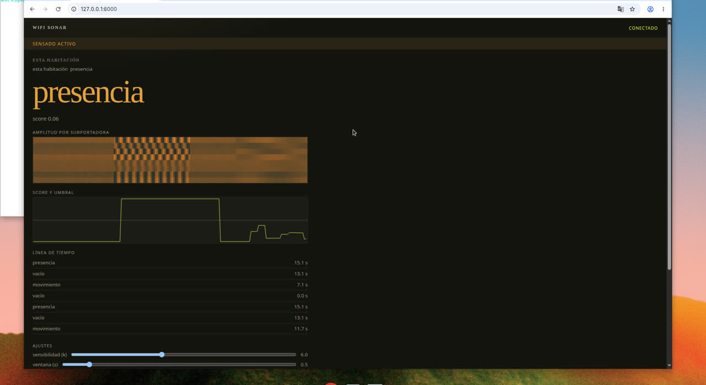
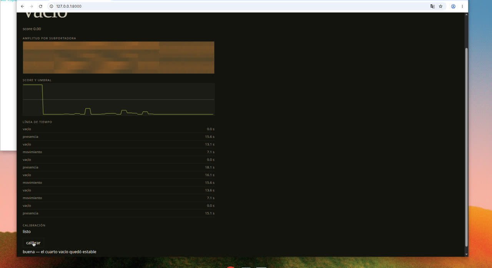

# wifi sonar

Panel local que usa el WiFi del hogar como sensor de presencia y movimiento. Todo el procesamiento corre en tu red. No hay telemetría ni nube por defecto, y no identifica personas.



## Qué detecta

Tres estados, en tu casa y con acuerdo de quienes viven ahí:

- **vacío**: no hay una perturbación por encima de la línea base.
- **presencia**: alguien quieto. Usa una banda lenta, del estilo de la respiración.
- **movimiento**: alguien caminando.

Con más de un receptor se puede resumir por zona (living, pasillo) con fusión OR o por votación. El modo RSSI, si lo activás, solo mira dispositivos que vos nombrás y el panel lo marca como sensibilidad baja: no distingue a alguien quieto.

## Privacidad

- El aviso **sensado activo** queda visible mientras corre.
- **Pausar** corta la ingesta. **Borrar historial** elimina eventos y calibraciones de esta máquina. La configuración queda.
- Los eventos se borran solos según la retención (7 días por defecto).
- Un webhook, si lo configurás, solo puede ser `http://127.0.0.1` o `http://localhost`.
- No uses esto para mirar la red de un vecino u otra unidad del edificio.

## Instalación

Hace falta Python 3.11 o superior. En Debian o Ubuntu, el módulo `venv` está en el paquete `python3-venv`.

```bash
make dev
make serve
```

Abrí `http://127.0.0.1:8000`. El simulador publica una escena de 24 segundos (vacío, caminata, quietud) y la repite. Los datos quedan en `data/sonar.sqlite`.

Con Docker, en una Raspberry Pi o una mini PC:

```bash
docker compose up --build
```

El contenedor escucha en el puerto 8000. Si ya tenés otro proceso ahí, paralo antes.

## Calibración

1. Dejá la habitación vacía.
2. En el panel, **calibrar**.
3. Esperá la cuenta de 5 segundos.
4. Leé el resumen: **buena**, **corta** (menos de 8 s), **inestable** (la señal cambió a mitad de camino) o **alta** (la línea base quedó ruidosa, como si hubiera alguien).



Hoy la captura del botón es un cuarto vacío simulado. Con una placa ESP32, el mismo botón tiene que pasar a grabar esa fuente. Los materiales y el formato de línea están en [`docs/hardware.md`](docs/hardware.md) y [`firmware/README.md`](firmware/README.md).

## Ajustes

- **Sensibilidad (k)**: más chico, más sensible. Se usa en la próxima calibración.
- **Ventana**: segundos que el movimiento tiene que sostenerse.
- **Histéresis**: cuánto cuesta apagar el movimiento una vez encendido.
- **Notificación del navegador**: opcional, apagada hasta que la actives.
- **Fuente CSI o RSSI**: RSSI muestra el aviso de sensibilidad baja.

Los cambios se guardan y el simulador los toma en la traza siguiente.

## Límites conocidos

- Sin hardware, los números salen del simulador. `make eval` escribe precisión, recall y latencia de ese simulador en [`docs/eval.md`](docs/eval.md). No es una medición de una casa real.
- CSI a través de varias paredes y pisos deja de servir. No promete ver el edificio.
- RSSI no ve presencia quieta.
- El umbral dibujado en el gráfico de score es 0,5 de un score ya normalizado de 0 a 1.
- Falta un favicon: `/favicon.ico` responde 404.

## Desarrollo

```bash
make test
make lint
make eval
```

`make test` crea `.venv` si no existe. El backlog y las decisiones de diseño están en [`DEV_LOOP.md`](DEV_LOOP.md), [`PROGRESS.md`](PROGRESS.md) y [`DECISIONS.md`](DECISIONS.md).
