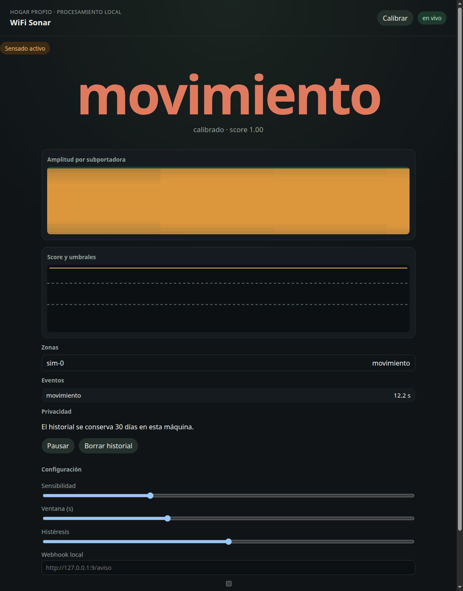
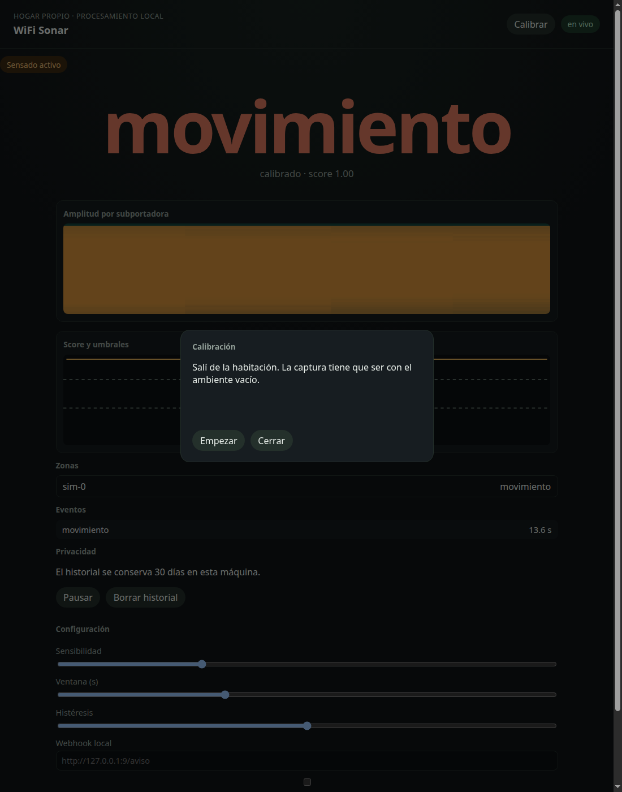

# WiFi Sonar

Panel local de presencia y movimiento a partir del WiFi de tu casa. Corre en tu máquina, con el simulador o con placas ESP32, y no manda telemetría a ningún lado.



## Qué hace

Clasifica el ambiente en tres estados: **vacío**, **presencia** y **movimiento**. Con más de un receptor podés nombrar zonas (living, pasillo). El modo RSSI, si no tenés CSI, usa solo dispositivos que vos nombrás y el panel lo marca como sensibilidad baja.

No identifica personas, no reconoce actividades íntimas y no arma un perfil de hábitos de nadie. El aviso **Sensado activo** está siempre visible. **Pausar** deja de leer la fuente. **Borrar historial** elimina los eventos guardados en esta máquina; la calibración del cuarto vacío se conserva.

## Instalación

Hace falta Python 3.11 o superior. En Debian/Ubuntu, también `python3-venv`.

```bash
make test
make lint
make eval
```

`make test` crea `.venv`, instala el paquete y corre la suite. `make eval` escribe `docs/eval.md` con precisión, recall y latencia del simulador.

Para levantarlo:

```bash
.venv/bin/python -m wifi_sonar
```

El panel queda en <http://127.0.0.1:8000> y la API en <http://127.0.0.1:8000/docs>. Las variables están en [`.env.example`](.env.example). Por defecto escucha solo en la máquina local y usa el simulador.

## Calibración

1. Dejá el ambiente vacío. Si hay alguien quieto, esa respiración entra en la línea base y después cuesta ver presencia.
2. En el panel, **Calibrar** → **Empezar**.
3. Hay 3 segundos de cuenta regresiva y después unos 12 segundos de captura.
4. El resumen dice si la calidad fue estable o ruidosa, y el umbral de movimiento.



Con el simulador, esa captura no usa el ciclo demo: arma un cuarto vacío aparte. En hardware real sí tenés que salir de la habitación. Cambiar la ventana o la sensibilidad aplica en caliente, pero los umbrales siguen siendo los de la última calibración hasta que vuelvas a calibrar.

## Docker

Con Docker y Compose:

```bash
docker compose up --build
```

Publica el panel en <http://127.0.0.1:8000> con el simulador. Los datos quedan en el volumen `sonar-data`. Para una Raspberry sin Docker está el ejemplo [`deploy/wifi-sonar.service`](deploy/wifi-sonar.service).

## Hardware

Sin placas, el programa usa el simulador. Para CSI de verdad hacen falta dos ESP32 y el ejemplo oficial `esp-csi`. Los materiales, el flasheo y el formato de línea están en [`docs/hardware.md`](docs/hardware.md) y [`firmware/README.md`](firmware/README.md).

```bash
WIFI_SONAR_SOURCE=esp32 WIFI_SONAR_ESP32_SERIAL=/dev/ttyUSB1 .venv/bin/python -m wifi_sonar
```

UDP, si usás el snippet de línea corta:

```bash
WIFI_SONAR_SOURCE=esp32 WIFI_SONAR_ESP32_PORT=5005 .venv/bin/python -m wifi_sonar
```

El modo degradado no escanea vecinos. Poné los nombres en `WIFI_SONAR_RSSI_DEVICES` y arrancá con `WIFI_SONAR_SOURCE=rssi`.

## Límites conocidos

- El CSI no atraviesa bien varias paredes. Un receptor por ambiente rinde más que subir la potencia.
- La primera decisión espera una ventana de unos 10 segundos: es lo que separa la respiración (0,1–0,5 Hz) del movimiento (0,5–5 Hz). Una persona quieta suma unos 3 segundos más.
- No hay identificación de personas ni de actividades finas. Movimiento y presencia quieta es todo el vocabulario.
- El RSSI es grueso. Sirve como respaldo y el panel lo dice.
- Sin hardware CSI, lo que ves es el simulador determinista, no tu casa.
- El historial se guarda en `data/wifi_sonar.sqlite` y se poda según la retención (30 días por defecto). No sale de esta máquina.

## Privacidad

Usalo en tu red y con acuerdo de quienes viven ahí. El proceso escucha en `127.0.0.1` salvo que lo pongas detrás de Docker, y aun así el compose publica el puerto solo en localhost. El webhook es opcional, local, y solo dispara cuando cambia el estado. No hay cuenta, no hay nube y no hay un modelo que reconozca quién está del otro lado de la pared.
