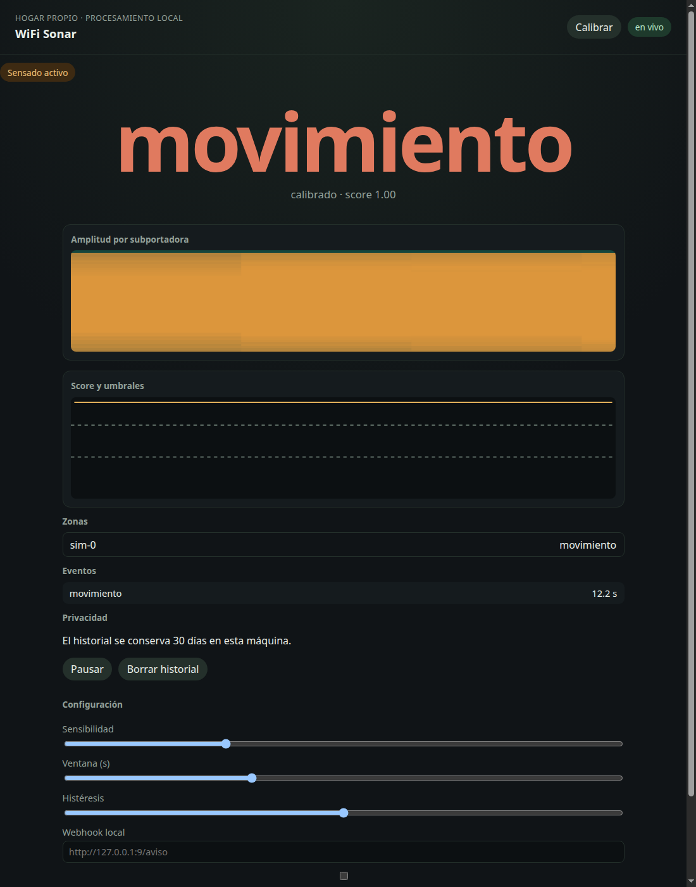
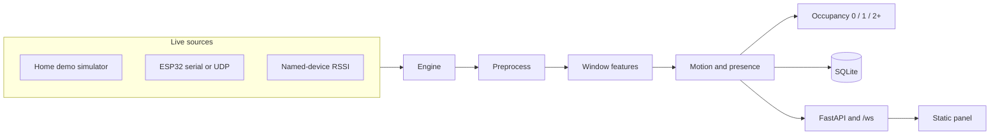

# WiFi Sonar

Local panel that treats the Wi-Fi in your own home as a motion sensor. It classifies the room as **empty**, **presence**, or **motion**, and it publishes an anonymous count of **0**, **1**, or **2+**. Nothing in that count is a name, a device identity, or a track.

The default source is a deterministic channel-state simulator, so the project runs without a radio. Two ESP32 boards running Espressif's `esp-csi` example can feed real CSI over serial or UDP. Processing stays on the machine that runs the panel.

Portfolio project by Nicolás Iavicoli Dulcet ([@iavicoliNicolas](https://github.com/iavicoliNicolas)), Computer Engineering student in Mar del Plata, Argentina.




The screenshots in this file are the local panel running on the simulator. The zone row in the image is labeled `sim-0`, from an earlier single-node capture. The default demo now publishes two nodes, `living` and `pasillo`. The UI copy is Spanish: `vacío`, `presencia`, `movimiento`.

## Features

- Three-state detector: `vacío` (empty), `presencia` (someone still), `movimiento` (motion). Motion wins over presence.
- Anonymous occupancy for the live view and the WebSocket: `0`, `1`, or `2+`, plus a confidence value. The count is not written into the history.
- Multi-node zones. Each `node_id` keeps its own window. Fusion is OR by default, or a vote. Zone names and a hand-placed floor sketch (x/y in 0..1) live in the local config.
- Live panel: subcarrier heatmap, score against the on/off thresholds, event list, calibration wizard, sensitivity sliders, pause, and history delete.
- One `CSISource` interface for the looping home demo, ESP32 lines, and a degraded RSSI mode. `ReplaySource` reads JSONL or CSV through the same pipeline. The server can record those files; `WIFI_SONAR_SOURCE` does not switch the live process to replay.
- Local HTTP API, OpenAPI at `/docs`, and a WebSocket at about 10 Hz that keeps only the latest snapshot.
- SQLite on disk for state changes, calibration, and config. Default retention is 30 days, using wall-clock time. The chart stays on trace time.
- Optional local webhook: a POST of the state change to a URL you set in the panel. A failed POST is logged and does not stop the detector.
- Record the frames already in memory (`POST /recording`) or a labeled session (`/recordings/start`, `/label`, `/stop`) and replay them through the same detector.
- Pause stops reading the source. Deleting history removes events and keeps the empty-room calibration.
- Structured JSON logs and `GET /health`. If a UDP socket dies, the process reopens it; after repeated failures `/health` reports `source: down` and HTTP keeps serving.

## How it works

A moving body changes the multipath between a Wi-Fi transmitter and a receiver. Channel state information (CSI) is the amplitude and phase per subcarrier. RSSI is a single power number and is much coarser. A normal home router does not expose CSI; the realistic radio path in this repo is a pair of ESP32 boards.



1. Each source yields `CSIFrame` values: timestamp, RSSI, amplitudes, optional phases, and `node_id`. The simulator uses 52 subcarriers at 100 Hz, with subcarrier 0 held at zero, Gaussian noise, a slow drift, and scripted `enter`, `walk`, `still`, and `leave` intervals. The same seed repeats the sequence.
2. Preprocess resamples onto a uniform grid, removes isolated spikes with a Hampel filter, drops dead subcarriers, and divides each subcarrier by its amplitude median.
3. Short windows (2 s, step 0.5 s) produce variance and the mean absolute difference. A 10 s Hann periodogram separates motion energy (0.5–5 Hz) from breathing energy (0.1–0.5 Hz). The first feature therefore arrives about 10 s into a trace.
4. Calibration records mean and standard deviation on an empty capture and sets thresholds at `mean + k·σ` with `k = 8`. The motion score is the 0.5–5 Hz band, scaled so 1 means the threshold. Hysteresis is 0.75 on and 0.40 off, and motion must hold for at least 1 s. Presence uses the breathing band and must hold for at least 3 s.
5. Occupancy counts spectral peaks in the latest window and caps the result at 2+. Two links active at once add up and then cap, and the confidence drops, because the signal cannot tell whether that is one person or two.

The default demo loops a 24 s scene: `living` walks from 6 s to 16 s and is still from 16 s to 24 s; `pasillo` has no scripted events. Startup on the simulator calibrates about 12 s of a separate empty room (same noise family, shifted seed), so the demo walk is not the baseline. On `esp32`, or when `WIFI_SONAR_UDP_PORT` is set, Calibrate uses recent frames from that source and marks a noisy capture as `ruidosa`.

The RSSI mode does not read the LAN and does not scan neighbors. `RssiSource` synthesizes one row per name you list in `WIFI_SONAR_RSSI_DEVICES`. In the demo only the first name moves. The panel shows a low-sensitivity warning, the state is only empty or motion, and occupancy confidence stays low.

## Tech stack

| Piece | Choice |
| --- | --- |
| Language | Python 3.11+ (developed and checked on 3.12) |
| Arrays and spectra | NumPy. No SciPy: the periodogram is a single Hann segment |
| HTTP and WebSocket | FastAPI, Uvicorn, `websockets` |
| Persistence | SQLite from the standard library |
| Panel | Static HTML, CSS, and JavaScript. No frontend framework |
| Packaging | `pyproject.toml` (setuptools), `requirements.txt` for the runtime libraries, Docker Compose, example systemd unit |
| Tests and lint | pytest, ruff (`make test`, `make lint`) |

## Requirements and how to run

**Software.** Python 3.11 or newer. On Debian or Ubuntu, `python3-venv` as well. No GPU, no cloud account, and no API key.

**What was run for this README.** On Python 3.12.3, `.venv/bin/pytest` passed 59 tests. The process below was started with `WIFI_SONAR_SOURCE=sim` and `WIFI_SONAR_SPEED=1` and served the panel, `/docs`, and `/favicon.ico` with HTTP 200. The simulator metrics in [docs/eval.md](docs/eval.md) were recomputed and matched the table already in the repo. Docker is not installed in that environment, so `docker compose up` was not re-run. No ESP32 was attached, so serial and UDP-from-hardware were not exercised. The parser tests use sample lines, not a flashed board.

**Hardware, if you want real CSI.** Two Espressif boards that expose CSI. Espressif's `csi_recv` / `csi_send` example is documented by them for the ESP32-C3; ESP32, ESP32-S3, C5, and C6 change the CSV, and the parser accepts both column layouts. Two USB cables, 5 V if a board is not powered by the host, and a computer on the same home network (a mini PC or a Raspberry Pi is enough). CSI does not cross several walls well; one receiver per room matters more than more transmit power. Parts, flashing, and the line format are in [docs/hardware.md](docs/hardware.md) and [firmware/README.md](firmware/README.md). This repository does not ship a firmware binary and does not depend on `pyserial`: the serial path is read as a text file or TTY.

```bash
python3 -m venv .venv
.venv/bin/pip install -U pip
.venv/bin/pip install -e .
.venv/bin/python -m wifi_sonar
```

`wifi-sonar` is the same entry point. The panel is at <http://127.0.0.1:8000> and the API docs at <http://127.0.0.1:8000/docs>. The process binds to `127.0.0.1` unless `WIFI_SONAR_HOST` says otherwise.

Development commands, from the `Makefile`:

```bash
make test    # venv, editable install with pytest and ruff, then pytest
make lint    # ruff check and format check
make eval    # rewrite docs/eval.md from the simulator
```

`requirements.txt` lists the same runtime libraries as `pyproject.toml`. It does not install the package; use `pip install -e .` for that. The dev extra (`pytest`, `ruff`, `httpx`) stays in `pyproject.toml`.

### Environment

Copy [`.env.example`](.env.example) if you want a file to edit. The process reads the variables below from the environment. `WIFI_SONAR_REPLAY` is parsed into settings and is not used by the running server. `WIFI_SONAR_WEBHOOK_URL` is listed in the example file and is not read; set the webhook from the panel or `PUT /config`.

| Variable | Default | Effect |
| --- | --- | --- |
| `WIFI_SONAR_HOST` | `127.0.0.1` | Bind address |
| `WIFI_SONAR_PORT` | `8000` | Bind port |
| `WIFI_SONAR_DB` | `data/wifi_sonar.sqlite` | SQLite file |
| `WIFI_SONAR_SOURCE` | `sim` | `sim`, `esp32`, or `rssi` |
| `WIFI_SONAR_SEED` | `0` | Simulator seed |
| `WIFI_SONAR_SPEED` | `1` | Trace seconds per wall-clock second. `0` does not sleep |
| `WIFI_SONAR_AUTOSTART` | `1` | `0` or `false` leaves the engine stopped |
| `WIFI_SONAR_RECORDINGS` | `data/recordings` | Where recordings are written |
| `WIFI_SONAR_RSSI_DEVICES` | `telefono` | Comma-separated names for RSSI mode. `*`, `scan`, and `all` are rejected |
| `WIFI_SONAR_ESP32_SERIAL` | empty | TTY or text file for `WIFI_SONAR_SOURCE=esp32` |
| `WIFI_SONAR_ESP32_HOST` | `0.0.0.0` | UDP bind address for an ESP32 source |
| `WIFI_SONAR_ESP32_PORT` | `5005` | UDP port when the source is `esp32` and `WIFI_SONAR_UDP_PORT` is unset |
| `WIFI_SONAR_UDP_PORT` | unset | Set it to replace the live simulator with UDP CSI lines |
| `WIFI_SONAR_WEB` | `web/` next to the package | Directory of the static panel. The Docker image sets `/app/web` |

ESP32 over a serial device:

```bash
WIFI_SONAR_SOURCE=esp32 WIFI_SONAR_ESP32_SERIAL=/dev/ttyUSB1 .venv/bin/python -m wifi_sonar
```

UDP only when you ask for it. Without the variable the process does not open the socket:

```bash
WIFI_SONAR_UDP_PORT=5005 .venv/bin/python -m wifi_sonar
```

RSSI demo (synthesized rows, not a scan of the network):

```bash
WIFI_SONAR_SOURCE=rssi WIFI_SONAR_RSSI_DEVICES=telefono,notebook .venv/bin/python -m wifi_sonar
```

### Calibration

Leave the room empty. A person sitting still during the capture becomes part of the baseline, and later presence is harder to see.

1. In the panel, choose **Calibrar**, then **Empezar**.
2. The dialog counts down 3 seconds, then `POST /calibrate` with `seconds: 12`.
3. The result reports quality `estable` or `ruidosa`, and the motion threshold.


### Docker and a Raspberry Pi

```bash
docker compose up --build
```

Compose publishes `127.0.0.1:8000` only, runs the simulator, and stores the database in the `sonar-data` volume. Inside the container the server binds to `0.0.0.0`. [`deploy/wifi-sonar.service`](deploy/wifi-sonar.service) is an example systemd unit for a machine without Docker. Neither path was executed while writing this README.

## Sample output

Captured from a real process on this tree: Python 3.12.3, `WIFI_SONAR_SOURCE=sim`, `WIFI_SONAR_SPEED=1`, trace time 41.91 s. `living` was in the walking part of the loop (`movimiento`, occupancy `1`). `pasillo` was `vacío`. The fused state follows OR, so the room is `movimiento`. The live payload has 52 amplitudes; the first four are shown and the rest are omitted here. The leading `0.0` is subcarrier 0, which the simulator holds at zero.

`GET /health`

```json
{
  "ok": true,
  "version": "0.1.0",
  "connected": true,
  "paused": false,
  "sensing": true,
  "source": "up"
}
```

`GET /status`

```json
{
  "state": "movimiento",
  "moving": true,
  "score": 1.0,
  "presence_score": 1.0,
  "calibrated": true,
  "paused": false,
  "sensing": true,
  "source": "sim",
  "mode": "csi",
  "node_id": "living",
  "ts": 41.91,
  "connected": true,
  "nodes": [
    {
      "node_id": "living",
      "state": "movimiento",
      "score": 1.0,
      "zone": "",
      "ts": 41.91,
      "occupancy_label": "1",
      "occupancy_confidence": 0.75
    },
    {
      "node_id": "pasillo",
      "state": "vacío",
      "score": 0.0,
      "zone": "",
      "ts": 41.91,
      "occupancy_label": "0",
      "occupancy_confidence": 0.85
    }
  ],
  "features": {
    "variance": 0.025579010853700214,
    "mad": 0.023728679589167197,
    "motion_energy": 49.54917963044191,
    "breath_energy": 0.011203560589110331
  },
  "amplitudes": [0.0, 0.8514987602083396, 0.8616899007564572, 0.8749414861637852],
  "occupancy_count": 1,
  "occupancy_label": "1",
  "occupancy_confidence": 0.75,
  "occupancy_low_confidence": false
}
```

Startup also logs one JSON line when calibration is saved, for example `{"level": "INFO", "logger": "wifi_sonar", "message": "calibration saved"}`.

Simulator metrics from [docs/eval.md](docs/eval.md), after a 20 s empty-room calibration with `k = 8`. These are scripted scenarios, not a measurement in a real apartment. Latency is the median from the start of the event to the first detection, and it includes the 10 s spectrum window.

| Scenario | Metric | Value |
| --- | --- | ---: |
| Empty room, 120 s | Motion false positives | 0 |
| Empty room, 120 s | Presence false positives | 0 |
| Walks | Recall | 1.000 |
| Walks | Precision | 1.000 |
| Walks | Median latency (s) | 1.990 |
| Stillness | Recall | 1.000 |
| Stillness | Precision | 1.000 |
| Stillness | Median latency (s) | 10.990 |

## Project structure

```text
wifi_sonar/
  __main__.py          python -m wifi_sonar / wifi-sonar
  api/app.py           FastAPI routes, static panel, /ws
  engine.py            ingest, per-node state, fusion, webhook
  models.py            CSIFrame
  settings.py          AppConfig and environment
  sources/             simulator, replay, ESP32, RSSI
  pipeline/            preprocess and window features
  detect/              calibration, motion, presence, occupancy
  storage/             SQLite and the in-memory store used in tests
  eval/                simulator precision, recall, latency
  recording.py         JSONL session and the recent-trace dump
  stream.py            latest-snapshot hub for /ws
  jsonlog.py           one JSON object per log line
web/                   index.html, app.js, style.css, favicon.png
firmware/              flash notes and csi_line.c (not an IDF project)
docs/                  hardware.md, eval.md, panel screenshots
tests/                 pytest suite
deploy/                example systemd unit
```

`DECISIONS.md`, `DEV_LOOP.md`, and `PROGRESS.md` are the development log, in Spanish. They record why SciPy and `pyserial` were left out, why the spectrum window is 10 s, and why the product stops at presence and motion.

## API

| Method | Path | Role |
| --- | --- | --- |
| `GET` | `/health` | Version, pause, sensing, source `up` or `down` |
| `GET` | `/status` | Fused state, nodes, features, amplitudes, occupancy |
| `POST` | `/calibrate` | Body `{"seconds": 12}`. Returns the baseline and `quality` |
| `GET`, `PUT` | `/config` | Sensitivity, windows, hysteresis, zones, layout, mode, webhook, pause |
| `GET` | `/history` | State changes. `limit` from 1 to 1000 |
| `DELETE` | `/history` | Deletes events. Keeps calibration |
| `POST` | `/recording` | Writes the in-memory trace to JSONL. 409 when fewer than two frames are buffered |
| `POST` | `/recordings/start`, `/label`, `/stop` | Labeled capture for replay |
| `GET` | `/ws` | WebSocket. Same payload as `/status`, about 10 Hz, old snapshots dropped |

## Technical highlights

- The pipeline and the detectors are functions over windows. Tests feed synthetic frames, so the suite does not need a radio, a network, or a browser.
- Motion uses the 0.5–5 Hz band on purpose. Broadband variance also rises with breathing, so it cannot separate a walk from a person sitting still. `k = 8` is the default because a lower `k` produced false walks on a 10-minute noise run.
- Interpolating the sample window uses a binary search on timestamps. A full distance matrix does not fit a 10-minute trace.
- Each node keeps its own buffer, detector, and occupancy. Changing a detector setting (sensitivity, windows, thresholds, durations, or mode) resets hysteresis. Zone names, the sketch, fusion, pause, retention, and the webhook do not.
- After 60 s of an empty state, each window mixes 1% of the observed motion and breathing energy into the mean. The mean stays within half of `max(|anchor|, σ)` of the saved anchor. That drift is not written to SQLite; a restart reloads the stored baseline.
- The WebSocket hub stores one snapshot. A slow client misses intermediate frames instead of growing a queue.
- History rows store `recorded_at` as wall-clock time and `ts` as seconds on the trace. The simulator starts at zero, so retention cannot use `ts`.
- Privacy controls are part of the product: a visible sensing banner, pause, local-only bind, no account, and no default telemetry. The occupancy field has no name and is not stored in SQLite.

## Known limits

- The first decision waits for the 10 s spectrum window. A still person needs about 3 s more on the breathing band. The stillness latency in the table above is about 11 s.
- There is no person identification and no fine activity recognition. The state vocabulary stays empty, presence, and motion. The count is only 0, 1, or 2+.
- There is no metric map. A CSI link says the room changed. It does not give angle of arrival, time of flight, or a position in meters. The floor sketch is whatever you place by hand.
- Two links active at the same time are not known to be the same person. The total caps at 2+ and confidence falls.
- RSSI mode is a coarse fallback, and in this repository it is synthesized from the names you type. It does not query the Wi-Fi interface.
- Without CSI hardware, the panel is the deterministic simulator, not your apartment.
- Occupancy on real CSI is not validated here. The 0 / 1 / 2+ tests are simulator cases. 2+ is a ceiling, not a census.
- Recordings and the database stay on this machine (`data/wifi_sonar.sqlite`, `data/recordings/`).

Use it on your own network, with the agreement of the people who live there. The development notes treat sensing other apartments as out of scope and cite Argentina's personal-data law (Ley 25.326) as the reason. The code has no account, no cloud upload, and no model that names who is on the other side of a wall.

## Resumen

WiFi Sonar es un panel local de presencia y movimiento a partir del Wi-Fi de tu casa. Clasifica el ambiente en vacío, presencia o movimiento, y muestra un conteo anónimo de 0, 1 o 2+. Corre en tu máquina con un simulador determinista o con dos placas ESP32 y el ejemplo `esp-csi`. No identifica personas, no arma un plano en metros y no manda telemetría. El panel queda en `http://127.0.0.1:8000`. La instalación, la calibración y los límites están más arriba, en inglés.
